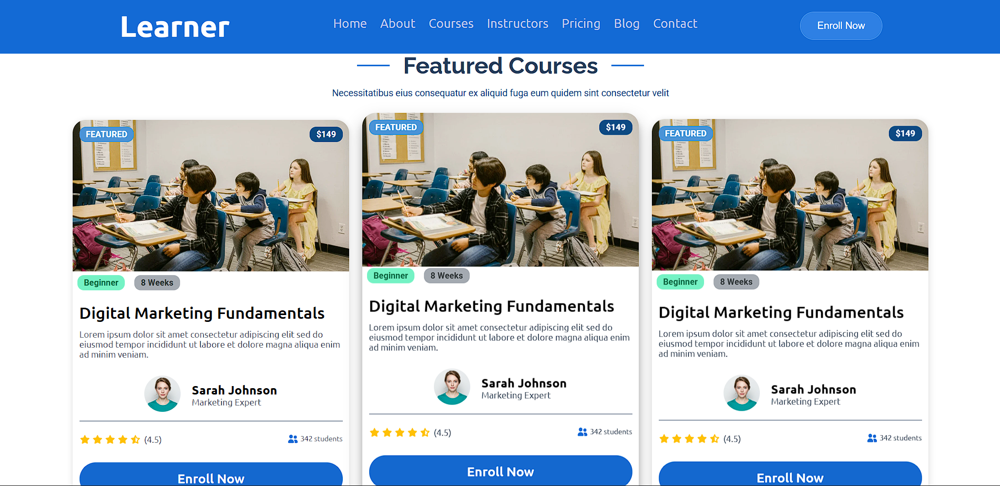
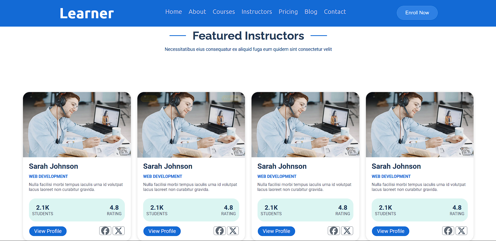
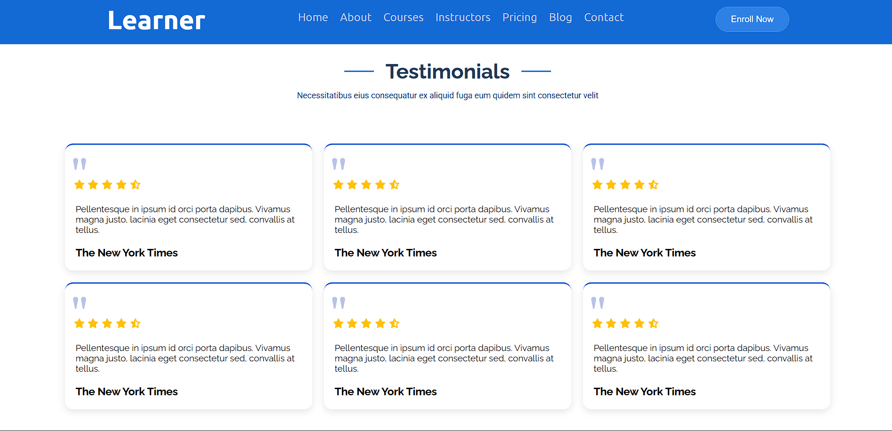
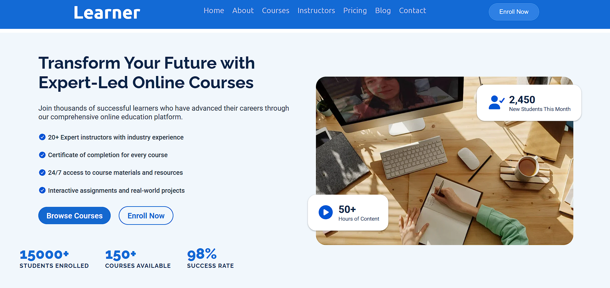
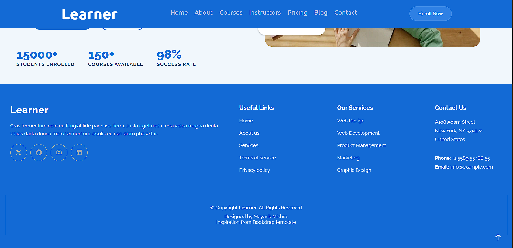

# Learner — Online Education Website

A modern **frontend-only educational website** built with HTML and CSS. Learner presents an online learning platform through a polished landing page featuring courses, instructors, student testimonials, and more.

The interface focuses on a clean layout, a consistent blue visual theme, interactive hover states, CSS transitions, and responsive styling for different screen sizes.

## Screenshots

### Home / Hero


### Featured Courses


### Featured Instructors


### Testimonials


### About / Learning Benefits


### Footer


## Features

- Responsive frontend layout designed for desktop, tablet, and mobile screen sizes
- Navigation bar with links to the website sections and an enrollment call-to-action
- Hero section with course discovery actions and learning-platform statistics
- Featured course cards with course details, instructor information, ratings, and enrollment buttons
- Instructor profile cards with student and rating statistics
- Testimonials section with star ratings and quote styling
- About / learning-benefits section with key platform highlights
- Footer with useful links, services, contact information, and social links
- CSS hover interactions, transitions, card lift effects, and visual feedback
- Reusable card styling and consistent typography, spacing, and color palette

## Tech Stack

- **HTML5** — semantic page structure
- **CSS3** — layout, responsive design, transitions, hover effects, and styling
- **Google Fonts** — typography
- **Font Awesome** — icons

## Project Structure

```text
Learner/
├── index.html
├── style.css
├── README.md
└── screenshots/
    ├── home-hero.png
    ├── featured-courses.png
    ├── featured-instructors.png
    ├── testimonials.png
    ├── about-section.png
    └── footer.png
```

## Run Locally

1. Clone or download this repository.
2. Open the project folder in VS Code.
3. Open `index.html` in your browser, or use the **Live Server** extension.
4. Resize the browser or use DevTools device emulation to check the responsive layout.

## Notes

This project is a frontend UI demonstration. The course, enrollment, profile, and contact controls are presentation elements unless connected to backend functionality.

## Author

**Mayank Mishra**

- GitHub: [mayankmishra191919-wq](https://github.com/mayankmishra191919-wq)
